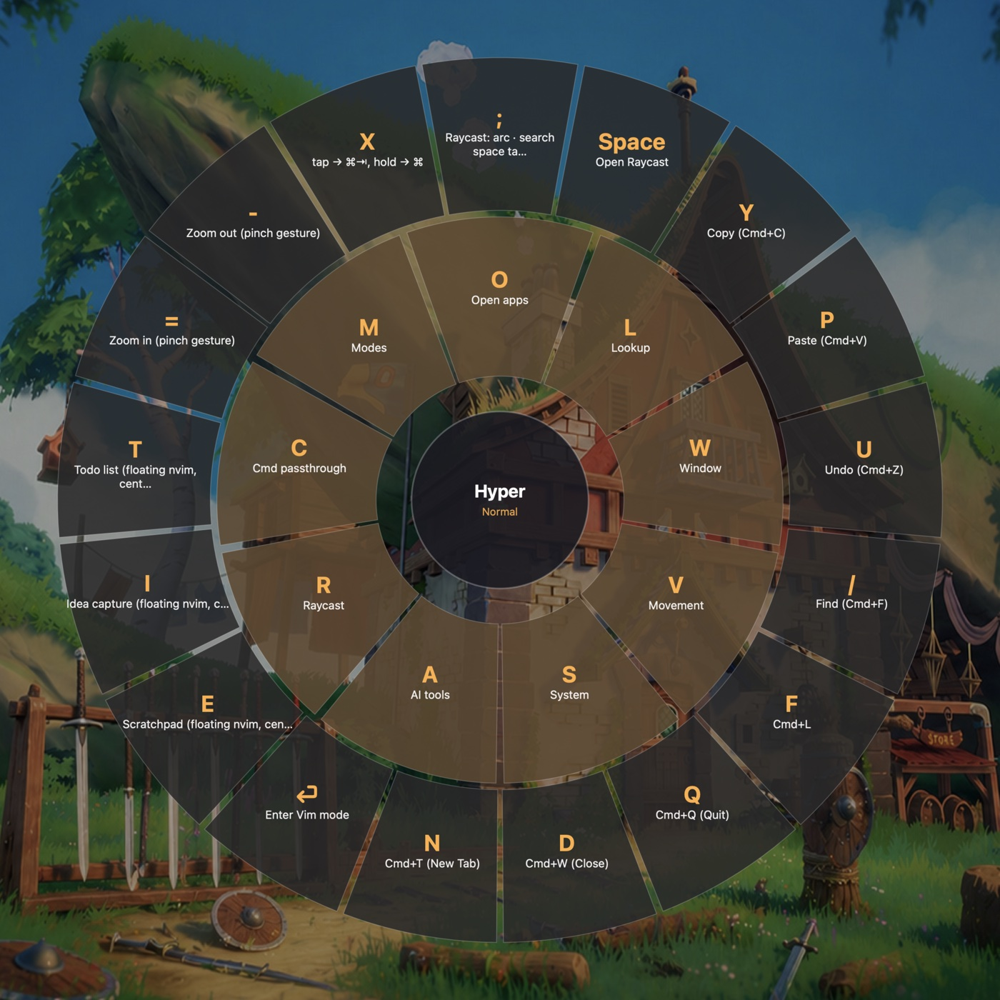

# karabiner-config

One unified [Karabiner-Elements](https://karabiner-elements.pqrs.org/) profile,
generated from TypeScript. Caps Lock becomes a **Hyper key** (⌃⌥⇧⌘) that opens
declarative sublayers; "modes" (Programming / Reading / Trivia) are instant
variable flips instead of slow profile switches; and two floating nvim windows
give one-keystroke scratch space and idea capture from anywhere — including
over fullscreen apps.

Forked from [@mxstbr's config](https://github.com/mxstbr/karabiner) and heavily
restructured.



*Hold Caps Lock for 400ms and the Hyper layer appears as a wheel: sublayers on
the inner ring, direct commands on the outer, each with its icon. Hold a
sublayer key and you get that sublayer's wheel instead.*

## Highlights

- **Hyper sublayers** — hold Caps Lock, tap a sublayer key, tap a command key.
  Declared as plain TypeScript maps in `profiles/`. Tap Caps Lock alone = Escape.
- **Instant modes** — one profile, mode-gated rules behind `variable_if`
  conditions. Switching (`Hyper+M, P/R/T/N`) is a variable flip: no config
  reload, no dropped keystrokes. Hammerspoon auto-switches modes per app;
  SwiftBar and tmux show the active mode.
- **`Hyper+E` — scratchpad**: a small floating nvim window (iTerm hotkey
  window), centered on your screen, self-clearing after 5 idle minutes. Real
  vim, not an emulation.
- **`Hyper+I` — idea capture**: same floating treatment; every summon starts a
  fresh timestamped markdown note that lands in an Obsidian vault folder when
  the window loses focus. Empty summons write nothing.
- **`Hyper+T` — todo list**: same floating treatment on a single persistent
  `todo.md` in the Obsidian vault (so it syncs); autosaves on focus loss,
  never cleared, picks up external edits on re-summon.
- **`Hyper+X`** — dual-role app switcher: tap = Cmd+Tab, hold = browse the
  switcher with Cmd held for you.
- **`Hyper+=` / `Hyper+-` — pinch-to-zoom**: synthesizes a real trackpad
  magnify gesture (via Hammerspoon), so it zooms apps that only respond to
  pinch (Preview, Safari, Maps, Photos). Falls back to ⌘=/⌘− for gesture-blind
  apps (Chromium/Electron).
- **Which-key HUD** — hold any sublayer key (`Hyper+O`) or Hyper alone for a
  beat and a GTA-style weapon wheel of its commands appears, every wedge
  with an SF Symbol or the app's icon. Drawn by a small native Swift agent
  (`hud/`) that Karabiner reaches over its `send_user_command` socket, from
  data generated at build time, so it can never drift from the real bindings;
  fast chords never see it. The wedge you hit lights up, and after the first
  command the wheel steps back to a quiet, letters-only state so repeated
  presses (volume, brightness) don't fight Apple's own bezel. App-specific
  bindings only show inside their app, and held-and-repeated layers (`v` for
  movement) opt out with `hud: false`. Entering a mode with bare-key bindings
  (Trivia's daily games) shows them as a wheel on its own, no hold needed;
  `Hyper+Space` brings it back.
- **Vim mode** (`Hyper+Enter`) — vim-style navigation/editing anywhere.

The full keymap lives in the source — `profiles/normal.ts` is the assembler
and the place to look first. The tables in code are the source of truth;
nothing here will drift out of date.

**[📋 CHEATSHEET.md](./CHEATSHEET.md)** is a rendered reference of every
binding, grouped by mode. It's auto-generated from the source by
`yarn cheatsheet` (and on every `yarn build`), so it can't go stale.

## Requirements

- macOS
- [Karabiner-Elements](https://karabiner-elements.pqrs.org/)
- Node.js + yarn (build tooling)
- Xcode Command Line Tools (`xcode-select --install`) — `swift` builds the
  native which-key HUD in `hud/`
- Optional but recommended:
  - [Hammerspoon](https://www.hammerspoon.org/) — pinch-zoom, per-app mode
    auto-switching, floating-window centering, and the fallback HUD renderer.
    `setup.sh` also links its `hs` CLI into your Homebrew `bin`.
  - [iTerm2](https://iterm2.com/) + [Neovim](https://neovim.io/) — the
    scratchpad / idea-capture / todo floating windows
  - [SwiftBar](https://swiftbar.app/) and/or tmux — mode indicators
  - [cliclick](https://github.com/BlueM/cliclick) — Reading-mode screenshot
    macros only

Everything degrades gracefully: without Hammerspoon the keybindings still
work, you just lose zoom and auto-switching; without `swift` you lose the
wheel (or flip `HUD_RENDERER` in `utils.ts` to `"hammerspoon"` for the
original Hammerspoon-drawn one).

## Install

```sh
git clone https://github.com/asonkiya/karabiner-config.git
cd karabiner-config
./setup.sh
```

`setup.sh` is idempotent and backs up anything it replaces to
`~/.karabiner-config-backups/<timestamp>/`. It:

1. Checks dependencies and installs node modules
2. Rewrites the author's hardcoded paths (repo location, Homebrew prefix) for
   your machine
3. Symlinks `~/.config/karabiner` → the repo and `~/.hammerspoon` →
   `hammerspoon/`, and links Hammerspoon's `hs` CLI into your Homebrew `bin`
   if it isn't there yet
4. Symlinks the iTerm dynamic profiles (`iterm/*.json`) into
   `~/Library/Application Support/iTerm2/DynamicProfiles/`
5. Installs the SwiftBar indicator if SwiftBar is present
6. Installs a LaunchAgent that rebuilds `karabiner.json` at login (so a
   `git pull` never leaves Karabiner on a stale config)
7. Builds the native HUD (`hud/`, `swift build`) and installs the LaunchAgent
   that keeps it running (`com.karabiner-config.hud`, logs to
   `/tmp/karabiner-hud.log`). Re-run `setup.sh` after pulling changes to
   `hud/`.
8. Runs the initial build (`karabiner.json`, `CHEATSHEET.md` and the HUD's
   `hammerspoon/sublayers.json`) and reloads Karabiner and Hammerspoon

Then follow the printed manual steps (permission grants, optional Login
Items). The ideas/todo vault paths are personal — `VAULT` in
`iterm/ideas.lua`, `TODO` in `iterm/todo.lua`.

## Customizing

```sh
yarn watch   # rebuilds karabiner.json on every save
```

- **Keybindings**: `profiles/normal.ts` (everyday bindings + global
  sublayers), `profiles/programming.ts` / `reading.ts` / `trivia.ts`
  (mode-gated fragments).
- **Adding a mode**: add it to `MODE_NAMES` in `utils.ts`, create a gated
  fragment in `profiles/`, spread it in `normal.ts`, map an app in
  `hammerspoon/apps.lua`, add it to the indicators. (Step-by-step in
  `AGENTS.md`.)
- **Floating windows**: size/behavior in `iterm/*.json` (rows, columns,
  hotkey); nvim-side behavior in `iterm/*.lua`. After editing a profile JSON,
  reload it with `touch -h` on its symlink in `DynamicProfiles/` — deleting
  and recreating the symlink makes iTerm silently drop the hotkey.
- **Indicators**: `indicators/karabiner-profile.2s.sh` (SwiftBar),
  `indicators/tmux-status.conf` (append to `~/.tmux.conf`).
- **Which-key HUD**: `hud/Sources/KarabinerHUD/Theme.swift` holds every
  number — size, ring proportions, colours, type, the 400ms hold, the 100ms
  lit flash, the 140ms step-back into the quiet state. Icons are inferred
  from what a command does (volume keys, `open -a`, URLs get their site's
  favicon, fetched once and cached under `~/Library/Caches/karabiner-hud`); add
  `icon: { symbol: "..." }` or `icon: { app: "..." }` to a command or a
  sublayer map to override, and `hud: false` to a sublayer map to keep it
  off the wheel. `HUD_RENDERER` in `utils.ts` switches back to the
  Hammerspoon wheel (`HUD_*` constants in `hammerspoon/init.lua`).

## Architecture

`yarn build` runs `rules.ts` via `tsm`, which writes `karabiner.json`. Since
`~/.config/karabiner` is a symlink to the repo, Karabiner hot-reloads on every
build.

Why one profile instead of several: `karabiner_cli --select-profile` reloads
the whole config (~1–2 s, drops keystrokes). Modes here are just variables
gated with `variable_if` conditions — switching is instantaneous, and
mode-specific bare keys (e.g. Reading's arrow remaps) simply don't apply
outside their mode. Mode state is mirrored to `/tmp/karabiner_mode_*` flag
files, which the indicators read.

| Path | Role |
|---|---|
| `rules.ts` | entry point — emits the single profile |
| `profiles/` | `normal.ts` assembles everything; other files are mode-gated fragments |
| `utils.ts` | sublayer generator, mode machinery, command helpers |
| `types.ts` | Karabiner JSON schema types |
| `hud/` | overlay agent: a Swift app fed by Karabiner's `send_user_command` pings; draws the which-key wheel, extensible to other overlays |
| `hammerspoon/` | per-app mode auto-switching, floating-window centering, pinch-zoom, fallback which-key HUD, boot resilience |
| `iterm/` | dynamic profiles + nvim overlays for the scratchpad and idea-capture windows |
| `indicators/` | SwiftBar plugin + tmux status snippet |
| `cheatsheet.ts` | walks the assembled profile to generate `CHEATSHEET.md` and `hammerspoon/sublayers.json` (HUD data) |
| `setup.sh` | idempotent installer |

## License

Copyright (c) 2022 Maximilian Stoiber, licensed under the
[MIT license](./LICENSE.md).
